# Jarvis architecture diagrams

Every box is a real module in this repository. Border legend (Mermaid class): **impl** = implemented and unit-tested; **advisory** = implemented and tested but
not yet wired into the live loop; **unverified** = implemented, but its real-hardware/real-device behaviour has not been checked; **planned** = not built.
Nothing marked *planned* exists. View with any Mermaid renderer (GitHub, VS Code "Markdown Preview Mermaid Support").

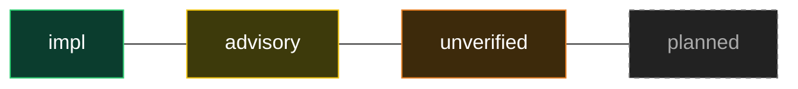

## 1. Unified architecture

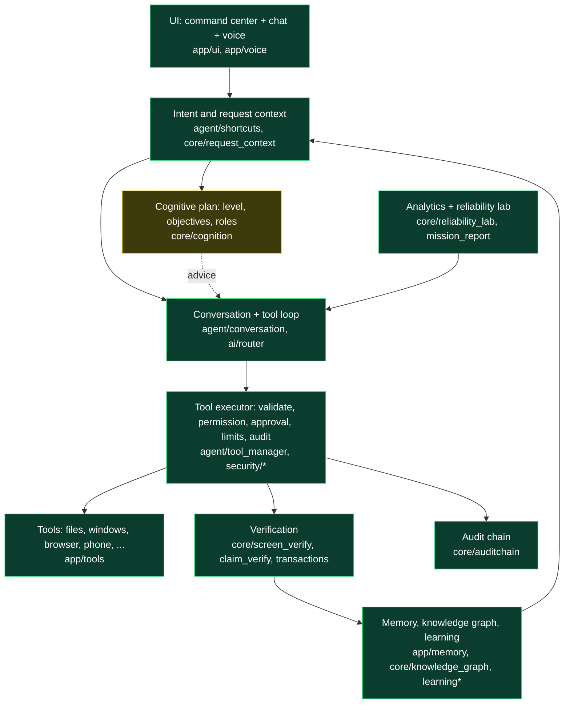

## 2. Cognitive brain network (roles, not separate chatbots)

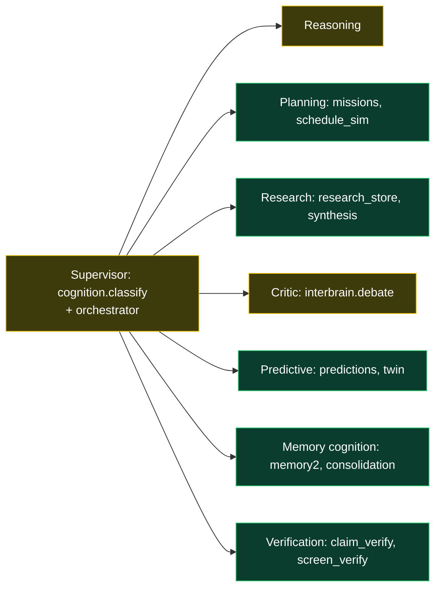
Roles are selected as names by `cognition.brains()`; the executors that already exist (agents, orchestrator) carry out the work. A separate "creative brain" and
"social brain" are not separate components; they are prompt styles of the one chat model.

## 3. InterBrain communication

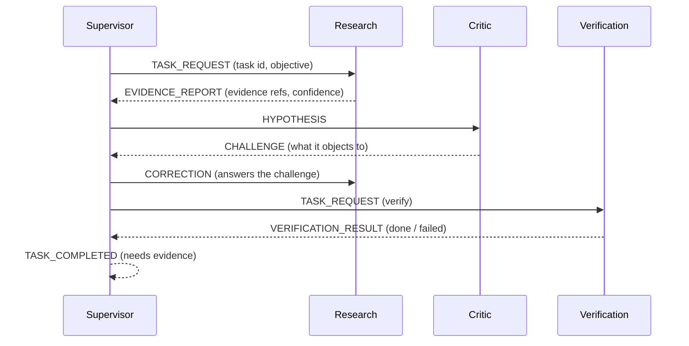
`core/interbrain.py` validates the contract and keeps a bounded timeline; **advisory** (the live mission loop still uses `core/blackboard.py` entries).

## 4. Capability composition

Generated *code* is not produced (the foundry composes existing tools only); that needs an OS-level sandbox decision.

## 5. Meta-intelligence orchestration

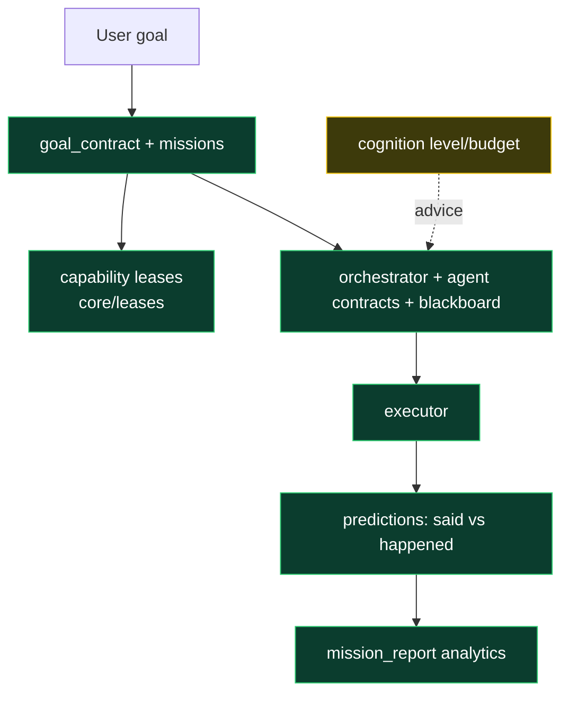

## 6. Memory and knowledge

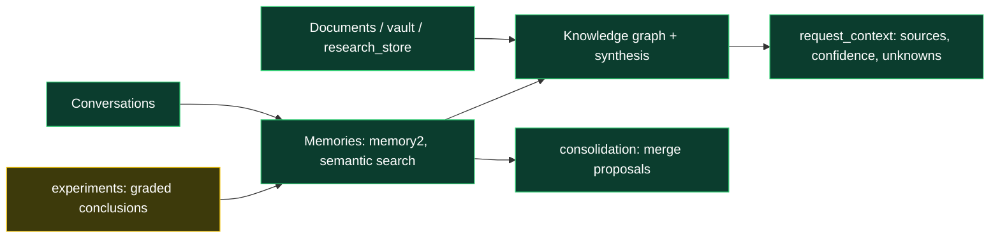

## 7. Model routing and resources

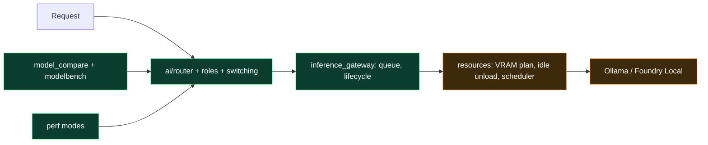

## 8. Failure detection and recovery

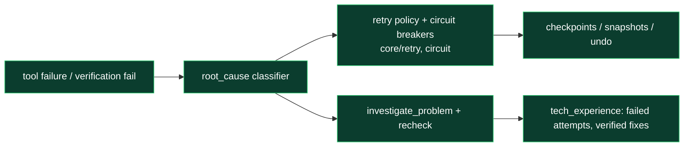

## 9. Execution and verification

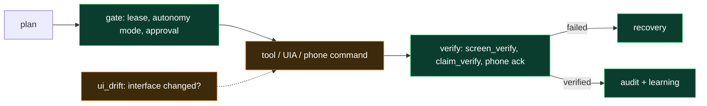

## 10. Cross-device

## 11. Learning loop

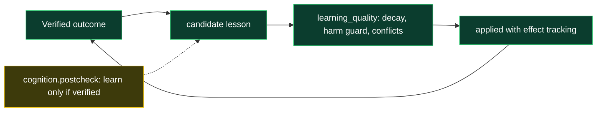

## 12. Security and permission boundaries

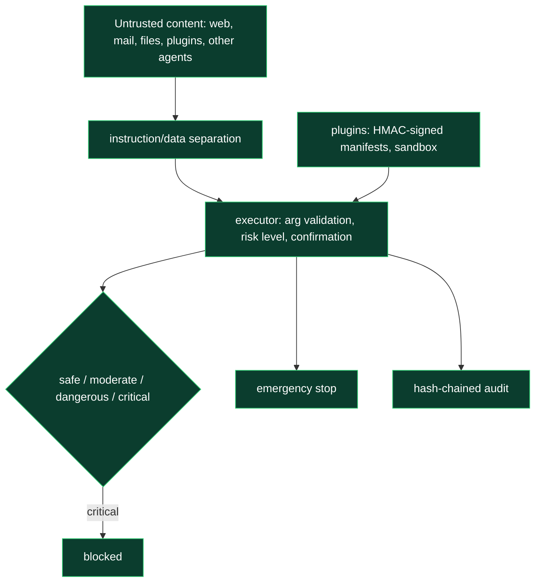
